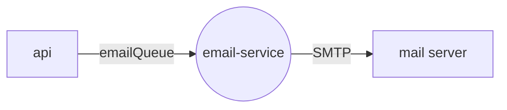

<div align="center">

<a href="https://gitlab.com/pingtower"></a>

# 📨 email-service

### Renders and sends every PingTower email over SMTP — with retries and a circuit breaker

[](https://gitlab.com/pingtower/email-service/-/pipelines)


<sub>Part of <a href="https://gitlab.com/pingtower"><b>PingTower</b></a> — real-time server availability monitoring</sub>

</div>

---

## Role in the system

The [api](https://gitlab.com/pingtower/api) never talks to SMTP directly: it drops a small message with a
recipient, a template id and template data into `emailQueue`. email-service renders the template and
delivers it, so slow or flaky mail servers never block user requests or alert processing.



## Features

- **File-based templates** — each template is a folder with `subject.txt` and `body.html`; `{{placeholders}}` are filled from the message data.
- **Built-in templates:**

  | Template id | Sent when | Data |
  | --- | --- | --- |
  | `registration-confirmation` | a user registers | `userName`, `verificationUrl` |
  | `password-reset` | a user requests a reset | `recipient`, `resetUrl` |
  | `server-down` | a server goes `DOWN` | `serverName`, `host`, `status`, `timestampUtc` |
  | `server-up` | a server recovers | `serverName`, `host`, `status`, `timestampUtc` |

- **Resilient delivery** — Polly retry on SMTP command errors (3×, exponential backoff), 10 s timeout, circuit breaker (opens for 2 min after 5 failures).
- **No poison loops** — invalid or undeliverable messages are rejected without requeue.

## Contracts

| Direction | Channel | Name | Payload |
| --- | --- | --- | --- |
| ⬅️ In | work queue (default exchange) | `emailQueue` | `{ "email", "templateId", "data": { … } }` |
| ➡️ Out | SMTP | `EMAIL_SERVICE_SMTP_*` | rendered HTML email |

## Quick start

**Whole stack** — via [infra](https://gitlab.com/pingtower/infra) (all repos cloned side by side):

```bash
make -C infra up
```

**This service only** (broker already running from infra):

```bash
cp .env.example .env    # fill in SMTP credentials
docker compose up -d --build
```

**Local development:**

```bash
dotnet run --project src/EmailWorker
dotnet test src/src.sln
```

## Structure

```text
email-service/
├── src/
│   ├── Domain/            # EmailSender, IEmailTemplateRenderer
│   ├── Application/       # MessageDto
│   ├── Infrastructure/    # MailKit sender, Polly decorator, template renderer
│   └── EmailWorker/       # hosted worker + Templates/<template-id>/{subject.txt, body.html}
└── tests/                 # unit and integration tests
```
